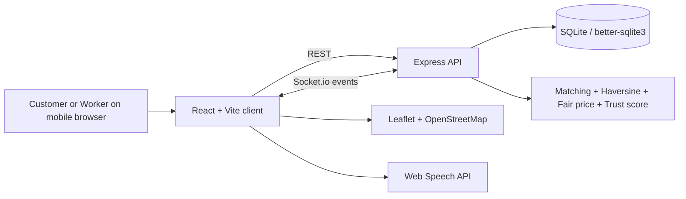

# Selene — Kaam bhi, Bharosa bhi

Selene is a mobile-first, hyperlocal on-demand services prototype for India's blue-collar service economy. It helps customers find nearby plumbers, electricians, cleaners, maids, cooks, painters and other local professionals, while giving workers control over their rates, availability and work pipeline.

> **Hackathon prototype note:** OTP delivery, ID verification, background checks and SOS dispatch are deliberately mocked and labelled in the product. Maps use real OpenStreetMap tiles; location defaults to Mumbai when browser geolocation is unavailable.

## Problem

Customers often rely on informal referrals for urgent home services and have limited visibility into availability, pricing or quality. Local workers face inconsistent demand and little control over how they present their skills. Selene makes the local service market more transparent: workers set rates, customers negotiate, and both sides build trust through verification, ratings and safety tools.

## What works in this prototype

### Phase 1 — complete core flow

- Mock phone + OTP authentication with customer and worker roles.
- Worker profile with skills, rates, radius, availability and demo voice onboarding.
- Customer request flow: category, issue, now/schedule, location and budget.
- Fair-price range and live Fair / High / Low price indicator.
- Haversine distance matching, worker ranking, ETA and 30-minute highlighting.
- Leaflet + OpenStreetMap live map with customer and worker pins.
- Socket.io job rooms for live offers and lifecycle updates.
- Worker accept / counter / decline and customer accept / counter / reject flows.
- Maximum three negotiation rounds with a visible timeline.

### Phase 2 — trust and safety

- Phone, ID and background verification levels on worker cards.
- Transparent 0–100 trust score (verification, rating, completion and response time).
- Star rating and review tags after completion.
- SOS simulation, family trip share and arrival check-in controls.
- Worker and customer live job lifecycle: Requested → Offers → Confirmed → On the way → In progress → Completed → Rated.

### Product differentiators

- Demo Mode floating switch between Customer and Worker views without logging out.
- “Refresh nearby crew” action to make nearby availability visible immediately.
- Worker-friendly large accept/decline cards and high-contrast mode.
- English / हिन्दी / मराठी toggle on the main screens.
- Voice onboarding using the Web Speech API where the browser supports it.
- Worker earnings dashboard with lightweight CSS charts.
- Low-bandwidth inbox note and no heavy image assets.
- Read-only admin summary endpoint for future judge / jury walkthroughs.

## Architecture



## Tech stack

- Frontend: React, Vite, Tailwind CSS foundation with a custom mobile-first visual system.
- Backend: Node.js, Express, Socket.io.
- Database: SQLite via better-sqlite3; zero external database setup.
- Maps: Leaflet with OpenStreetMap tiles; no API key.
- Voice: browser Web Speech API.
- Charts: Recharts with a lightweight CSS fallback aesthetic.

## Run the prototype locally

This project is intentionally not deployed. To use the prototype, run it on your computer and open the local development URL in a browser.

### Requirements

- Node.js 18 or newer
- npm
- A modern browser such as Chrome, Edge or Safari

### Start the app

```bash
# Clone the repository
git clone https://github.com/harshitkadam-461/selene.git
cd selene

# Install dependencies
npm install

# Create/seed the local SQLite database
# Safe to run more than once
npm run seed

# Start the frontend and backend together
npm run dev
```

After `npm run dev` starts, open **http://localhost:5173** in your browser.

The frontend runs on port `5173` and the local API runs on port `4000`. Keep the terminal running while using the prototype. Press `Ctrl+C` to stop the local server.

If port `5173` or `4000` is already in use, stop the other development server and run `npm run dev` again.

Optional configuration is documented in `.env.example`:

```bash
cp .env.example .env
```

No real keys are required.

## Using the prototype

No account, SMS provider or external API key is required. The OTP is generated and displayed in the prototype.

- Customer phone: `9000000000` (or any 10-digit number)
- Worker demo phone: `9000000001` to load seeded Ramesh Patil, or any number for a mock worker shell
- OTP: click **Send one-time code** and enter the four digits displayed in the on-screen demo hint

To try the main flow:

1. Open **http://localhost:5173**.
2. Choose **I need a service** and sign in with any 10-digit phone number.
3. Enter the one-time code shown on screen.
4. Create a request, for example a plumber for a leaking kitchen tap.
5. Use **Refresh nearby crew** to display seeded workers near Mumbai.
6. Use the floating **Switch view** control to switch between Customer and Worker views.
7. Accept an offer, confirm the job, move through the simulated job status, and leave a rating.

The default demo location is Mumbai. If browser location access is unavailable, the app uses Mumbai coordinates automatically.

## 2-minute demo script

1. Open the landing page and select **EN** / **हिन्दी** / **मराठी** to show inclusion.
2. Tap **I need a service**, enter any phone number, click **Send one-time code**, and enter the visible OTP.
3. Tap **Refresh nearby crew**. Point out the map, verification badges, distances, ETAs and live availability.
4. Tap **Start** under “What needs fixing?”, choose **Plumber**, leave “Leaking kitchen tap”, select **Now**, set `₹500` and submit.
5. Show the live map and the negotiation room. In a second browser tab or by using the floating Demo Mode switch, open the worker view.
6. In Worker view, press **Open & accept**. Switch back to Customer view and press **Confirm** on the incoming offer.
7. Tap **On the way** to show the simulated journey, then **Start work**, **Complete**, and **Rate job**.
8. Open the safety centre to show **Simulate SOS alert** and **Share trip with family**.
9. Switch to Worker view and show earnings, trust score, large action buttons and voice onboarding.

For a guaranteed demo, seed data starts around Mumbai (`19.0760, 72.8777`) and the location fallback uses the same point.

## Important implementation notes

- Matching is performed in `server/index.js`: Haversine distance filters by each worker's service radius, then sorts by 30-minute ETA, distance, rating and trust score.
- Negotiation is persisted in SQLite and each worker/job pair is limited to three rounds.
- Trust score is explained in `server/db.js` and is intentionally deterministic for judge-friendly transparency.
- The app labels OTP, verification, SOS and simulated nearby workers as demo functionality.
- The worker inbox includes a low-bandwidth note; a production version would use a service worker, local queue and SMS fallback.

## Screenshot placeholders

Add final hackathon screenshots here after recording the demo:

- `[ ] Landing + language picker`
- `[ ] Customer matching map`
- `[ ] Negotiation room with fair price`
- `[ ] Worker inbox + earnings`
- `[ ] Safety centre`

## Future scope

- Production-grade ID / Aadhaar verification through an approved provider.
- Background verification partners and insurance / accident cover.
- UPI escrow, invoices, refunds and worker tax-ready earnings statements.
- Offline-first PWA job inbox with conflict-safe sync.
- Community ratings, dispute resolution and multilingual voice support for more Indian languages.
- Organization / housing-society accounts and repeat service subscriptions.
